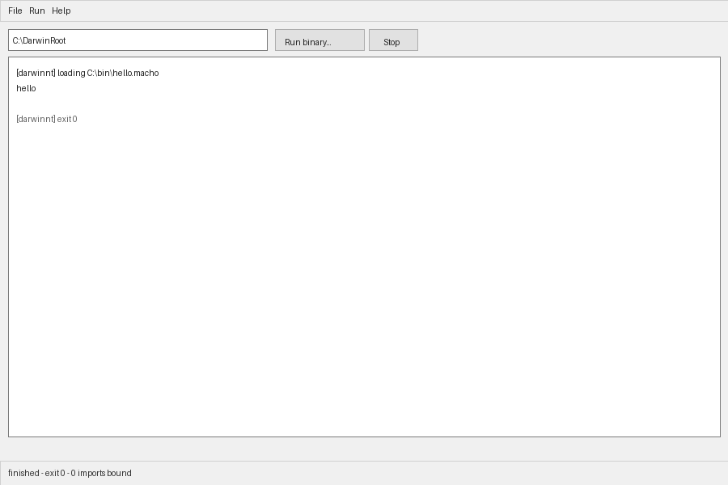

# darwinnt

Darwin userland on Windows, x86-64, no VM, no Mac.

The goal is to run real iOS/macOS command-line binaries on Windows by
implementing the layer they expect: Mach-O loading, Darwin syscalls, and the
filesystem semantics — not by emulating a phone.

## What this is not

- **Not an iOS emulator.** It cannot boot iOS or run App Store apps. SpringBoard,
  UIKit, the ARM64 runtime, and DRM are out of scope, permanently.
- **Not Darling.** No shared code, no reimplementation of CoreFoundation/AppKit.
- **Not finished.** See the status table. Most syscalls still return `ENOSYS` and
  say so, loudly, rather than guessing.

## What works today

| Component | State |
|---|---|
| Mach-O 64-bit parser | Loads real images; validates header, segments, file ranges |
| Chained fixups (`LC_DYLD_CHAINED_FIXUPS`) | Decodes PTR_64 / arm64e, multi-start pages |
| Classic bind opcodes (`LC_DYLD_INFO`) | Bind + lazy bind streams |
| Path translation | `/` → config root, `/var`→`/private/var`, traversal rejected |
| Filesystem (VFS) | fd table, cwd-relative resolution, `struct stat`, packed dirents |
| Host port backends | POSIX + Win32 behind one interface; Win32 exercised in CI |
| Syscall dispatch | 421-call table from XNU; **31 implemented** |
| ARM64 interpreter | entry-code subset; `svc #0x80` trapped, Darwin x0+carry convention |
| Executes real binaries | `hello`, `exit(42)`, and `ENOSYS` fixtures pass on Windows CI |
| Symbol binding | libSystem symbol table + trampolines; **lazy stubs not resolved yet** |
| ASan/UBSan clean fuzzing | 20k mutated images per CI run, plus local campaigns |

The loader is the part with real mileage: it was fuzzed to 18,000+ mutated
images at the exact allocation size a real loader would use.

## Build

Windows (what CI does):

```sh
x86_64-w64-mingw32-gcc -std=c11 -Wall -Wextra -Wpedantic -O2 -static \
  -Iinclude -Isrc src/main.c src/dnt_macho.c src/dnt_path.c \
  src/dnt_syscall.c src/dnt_win.c -o darwinnt.exe
```

Any host (tests, tooling):

```sh
make            # host CLI
make check      # three suites
make SAN=1 check  # with ASan/UBSan where the runtime exists
```

## Use

```
darwinnt --info <binary>        # load commands, segments, fixup inventory
darwinnt --translate /var/tmp/x # show host path mapping
darwinnt --test                 # built-in sanity checks
```

## Design

**Trap, don't imitate.** Each `svc` lands in a dispatcher keyed by the real XNU
number. A number with no handler is reported once and returns `ENOSYS`. This is
deliberate: a plausible zero from a fake `getpriority` hides a bug for weeks.

**Bounds are established at parse, not at use.** Every fuzz bug found in this
loader had the same shape — a value from the file used to compute an address
before anyone proved it fit the buffer. The fix pattern throughout is to reject
impossible geometry once, at parse time, so later code cannot be handed an
impossible map.

**Struct layouts are verified, not remembered.** `struct stat` is 144 bytes with
`st_ino` at 8 and `st_size` at 96, because Darwin's `mode_t` is 16-bit; the
chained-fixups segment record has `page_count` at 20, not 18. Each of these was
wrong on the first attempt and is now pinned by `_Static_assert` and tests.

## The Windows app

`darwinnt-gui.exe` is a native Win32 application (PE32+ GUI subsystem, no
console window): a binary picker, a Darwin root field, Run/Stop, a scrolling
monospace output pane, and a status bar reporting the exit code and how many
imports were bound.



Guest `write()` to fd 1/2 reaches the output pane through a port-layer output
sink rather than a console handle, so the same engine drives both front ends.
The guest runs on a worker thread; its output is posted to the UI thread and
appended there, never touching a control cross-thread.

Stop is honest: the interpreter has no interruption point yet, so it terminates
the worker thread and says that guest resources were not released.

## Running a Darwin binary

Real Darwin executables run, built by clang + ld64.lld (`tools/build-fixtures.sh`):

```
$ darwinnt --run tests/fixtures/hello.macho
hello
$ darwinnt --run tests/fixtures/exitcode.macho; echo $?
42
$ darwinnt --run tests/fixtures/badsys.macho; echo $?   # fork() is unimplemented
78
```

The interpreter covers the instruction subset linked entry code uses: moves,
ADRP/ADD address formation, conditional branches, loads/stores. Reaching an
instruction outside that set halts with the address and encoding rather than
guessing — an interpreter that improvises is worse than one that stops.

Three bugs the real binaries found that hand-made fixtures never would:

- `__PAGEZERO` (vmaddr 0, vmsize 4 GB) was rejected as "segment below base" —
  every real Darwin executable has one
- the executor used the file's link address as the mapping address, so segment
  copies landed at wild offsets
- `exit()` was dispatched through the host hook, which on Win32 calls
  `ExitProcess`: the guest's code was lost and the image never freed

## Dynamic linking: current limit

A *statically linked* image runs. A *dynamically linked* one does not yet, and
it fails honestly:

```
$ darwinnt --run dynwrite.macho
darwinnt: unresolved import reached dyld_stub_binder
  (lazy binding: the binary calls libSystem through stubs this loader cannot yet resolve)
```

What works: the bind/weak-bind opcode streams are decoded, a libSystem symbol
table (`write`, `read`, `open`, `stat`, `exit`, …) maps names to syscalls, each
resolved name gets its own trampoline address the interpreter recognises, and a
jump to an unresolved slot is reported by name instead of faulting.

What is missing: the lazy-binding handshake. lld emits each lazy call as

```
adrp x16, __la_symbol_ptr@PAGE ; ldr x16,[x16,#off] ; br x16
```

where the pointer initially leads to `dyld_stub_binder` with the symbol name
passed in x17. Resolving that needs either a real `libSystem.B.dylib` to bind
against (lld will not emit lazy bind entries against a synthesized stub) or an
implementation of the binder's stack/register protocol. Neither is faked here:
the test suite asserts the failure is clean and named, so the day it is fixed
the test flips deliberately rather than by accident.

## Filesystem

Implemented and tested end to end (`tests/test_syscalls_fs.c` drives the real
dispatcher with a simulated guest address space):

| Area | Syscalls |
|---|---|
| Open/close | `open`, `open_extended`, `close` |
| I/O | `read`, `write`, `lseek`, `ftruncate`, `fsync` |
| Metadata | `stat`, `lstat`, `fstat`, `stat64`, `lstat64`, `fstat64`, `access` |
| Directories | `getdirentries64`, `mkdir`, `rmdir`, `chdir` |
| Mutation | `unlink`, `rename` |
| Process | `exit`, `getpid`, `getppid`, `getuid`, `geteuid`, `getgid`, `getegid`, `gettimeofday` |

Darwin behaviour the tests pin down, because each one is a place a naive
mapping silently diverges:

- `/var/x` and `/private/var/x` reach the same file (prefix rewrite, no links)
- `open("/etc/motd/")` → `ENOTDIR`; reading a directory → `EISDIR`
- `..` above the root → `EACCES`, not a host path
- `getdirentries64` records are 8-byte aligned with correct `d_type`
- `struct stat` is 144 bytes with `st_ino` at 8 (Darwin `mode_t` is 16-bit)
- a guest pointer outside the registered region → `EFAULT`, never a host fault

## Syscall coverage

Generated from `spec/master.txt` (XNU `bsd/kern/syscalls.master`):

```
python3 tools/gen_syscalls.py spec/master.txt src/generated/syscalls.h
```

Adding a syscall means adding a `case DSYS_<name>:` to `dnt_syscall()`. If the
number is wrong, the generated table disagrees and a test fails.

## Layout

```
include/   dnt_abi.h (guest types), dnt_macho.h, dnt_path.h, dnt_syscall.h
src/       dnt_macho.c (loader), dnt_path.c, dnt_syscall.c, dnt_win.c (host)
tests/     three suites + a Mach-O fixture generator
tools/     gen_syscalls.py
spec/      XNU syscalls.master, mach-o headers, errno.h
```
